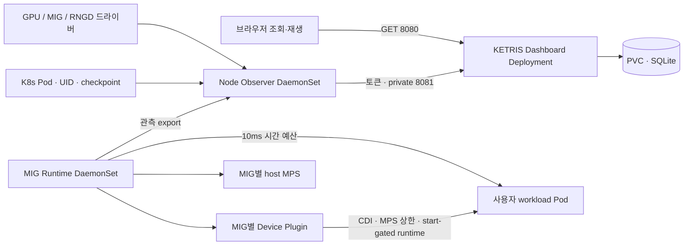

# KETRIS 전용 관측 대시보드

실시간 조회와 원본 실험 재생을 분리한다. GUI는 운영 제어를 변경하지 않는다. GPU→MIG→MPS 상한·시간 예산→Pod/컨테이너를 표시하고, RNGD PE 지도와 요청 경과 시간 기록도 제공한다. 미관측 값은 null/—, 연결 실패의 마지막 값은 stale로 표시한다. MPS는 전용 SM 소유권이 아니고 계상시간은 독점 장치 busy time이 아니다.

설치 형태는 UI/API **Deployment 1개**, node **observer DaemonSet**, **PVC의 SQLite**, public8080/private ingest8081 **Service 2개**다. 실제 GPU 제어는 별도 `ketris-mig-runtime` DaemonSet과 MIG별 Device Plugin/MPS 서버가 맡는다. NPU 실행은 기존 `ketris-device-plugin-lsu`의 PE 할당·기존 gate runtime을 사용한다. 플랫폼은 Job이 아니라 서비스이며, 사용자의 workload는 Pod 또는 Job으로 제출할 수 있다.



현재 설치 파일은 검증 노드 `gpu-npu-server-02 / 10.0.4.232`와 `local-path` StorageClass를 지정한다. 다른 노드는 host driver 경로·이미지 배포·nodeSelector·NetworkPolicy의 node CIDR을 실제 환경에 맞춰 지정해야 한다. API는 하나의 SQLite writer를 사용하므로 replicas=1/Recreate를 유지한다. history는5초 표본/7일 보존, observer는2초 전송, GPU/NPU는5초 수집, K8s watch+30초 resync다.

```bash
bash mig-sharing/tools/build.sh
bash dashboard/tools/build.sh
bash dashboard/tools/deploy.sh --dry-run=server
bash dashboard/tools/deploy.sh --apply
kubectl -n ketris port-forward svc/ketris-dashboard 8080:8080
```

브라우저: `http://127.0.0.1:8080`. 원격 PC에서 `ssh -L 8080:127.0.0.1:8080 root@10.0.4.232`를 유지한 뒤 같은 브라우저 주소를 연다. 포워딩은 loopback만 바인딩한다. public 포트에는 수집 POST와 실행·비율 변경 API가 없다. ingest는 별도 Service/NetworkPolicy와 Secret token으로 제한한다. Secret은 배포 시 생성하고 출력·커밋하지 않는다. hostNetwork 트래픽은 node CIDR 경계를 거치므로 token 검증도 필수다.

실험은 GPU host/MIG/RNGD 2026-10-12 원본과, 새 MIG 2026-10-13 12개 실제 측정 창을 projection한 bundle로 가져온다. source manifest는 사용한 원본의 SHA-256을 보존하고, 브라우저 증빙에는 허용된 metric/contract 필드만 제공한다. 요청 prompt·생성 텍스트·전체 env·모델 캐시는 포함하지 않는다. 절대 실행 시각이 원본에 없으면 측정 창/반복 축을 쓴다. 과거 MIG와 MOCK 기관 요청을 현재 장치/실제 기관 네트워크로 표시하지 않는다. RNGD70:30 정밀도 재현 실패와 완료 지연(TTFT가 아님)을 그대로 표시한다.

NPU gate 실시간 stats는 선택 사항이다. ConfigMap `ketris-observer-config`의 JSON 목록에 실제 Pod UID/container와 고정 `http://127.0.0.1:18180/stats` 또는18181 URL을 넣는다. owner가 확인되지 않은 gate를 Pod에 임의 연결하지 않는다. 현재 기본값은[]로 실제 driver 점유와 checkpoint 배치만 읽는다.

```bash
.venv/bin/python -m unittest discover -s dashboard/backend/tests -v
npm --prefix dashboard/frontend test -- --run
npm --prefix dashboard/frontend run build
KETRIS_UI_URL=http://127.0.0.1:8080 npm --prefix dashboard/frontend run test:e2e
```

브라우저 검증은 공식 Playwright Chromium을 사용한다(`npx playwright install chromium`). 실제 데이터·재생·증빙·키보드·1440/1024px를 확인하며 화면 캡처는 `reports/ketris_dashboard_20261013`에 저장한다. 새 runtime의 CUDA 실제 UUID와 옛 보고서의 환경 변수 UUID를 구분한다. 실제 제어 경로의 지원 범위·하드웨어 실측은 `../mig-sharing/README.md`를 참조한다.

2026-10-13 실제 설치 확인: `ketris-dashboard`와 `ketris-observer` 각각1/1, PVC4Gi Bound,4개 실제 archive를 제공한다. API 재시작 뒤 archive ID/live head/history 보존을 확인했다. 별도 namespace 테스트 Pod에서 public200/private ConnectTimeout, host의 무인증 ingest401/public ingest404를 확인했다. snapshot은 실제 GPU1개/RNGD8PE와2초 갱신을 표시한다.

`tools/verify_live_ui.py --url http://<public-service>:8080 --out reports/ketris_dashboard_20261013`는 유휴 GPU의 승인된 짧은 실험을 이용한다. 실제 두 Pod가 같은 MIG에50% MPS 상한/22SM, 시간75:25, actual CUDA UUID와 증가하는 커널을 표시하는지 확인한다. 2026-10-13 수행에서 이 검증과 브라우저 캡처, 재시작/cleanup이 통과했다. 최종 캡처는 측정 시작 플래그 후4초를 기다려 예열과 겹치지 않으며 두 계상 시간 증분이 모두 양수인 관측 창을 사용한다. 예열과 측정 결과는 구분한다. 현재 운영 하드웨어는 원래 MIG Disabled·LSU240·NPU PE8로 복원하고 관측 대시보드/observer는 유지했다.

최종 캡처 디렉터리: `reports/ketris_dashboard_20261013_final_window`. 캡처: `live-mig.png`, `mig-space.png`, `mig-time.png`, `mig-combined.png`, `rngd-combined.png`, `mig-new-runtime.png`, `evidence.png`, `responsive-1024.png`. 실제 API snapshot와 `live-ui-verification.json`, `listener-checks.json`, `api-restart.json`, `networkpolicy.json`도 같은 보고서 디렉터리에 있다.


2026-10-13 자원판 UI 변경: 화면은 선택한 관측 시점/측정 창의 자원판 하나만 표시한다. 워크로드 블록을 누르면 해당 기록의 요청·상한·SM·시간 비중·예산·크레딧·Pod UID·CUDA UUID를 상세 패널에서 볼 수 있다. 자세한 비교 표와 출처는 접힌 연구 자료 패널에 보존한다. 실시간은 최신 관측을2초마다 갱신하며, 시간 커서를 선택하면 화면을 고정한다. 최신 관측 따라가기로 돌아올 수 있다. API history의 recent=true는 최신500개까지 시간 순으로 반환하며 기존 cursor 조회는 유지한다. 기록 갱신 실패와 현재 조회 실패를 분리한다.

기존 실험 재생은 측정 창 단위이고 라이브 기록은5초 표본이다. 기록 사이 상태는 보간하지 않으며, 현재 수집되지 않는 순간 커널/요청 실행·게이트 대기 상태를 추정해서 칠하지 않는다. GPU는 원본 Pod/바인딩/예산 상태, NPU는 PE 배정과 별도의 드라이버 점유를 표시한다. 실제 CUDA UUID가 선택한 MIG와 일치하고 오래된 값이 아닐 때만 블록에 일치 확인을 표시한다. 상시 공간 재구성 기능은 추가하지 않는다.

기본 이미지: ketris-dashboard:20261014-gpu-state-v3. 원본 프로젝트와 이전 변경은 보존하며 feat/ketris-mig-dashboard 브랜치에서 개발한다. 원격 Git 업로드는 수행하지 않는다.

GPU 전체 지도에서 MIG 제목을 누르면 해당 파티션의 용량·UUID·연결 수를 표시하고 워크로드 선택을 초기화한다. 과거 NPU 배정은 원본 파티션의 PE 목록을 설정값으로 표시하고, 드라이버 점유와 구분한다. UUID 확인은 실제 CUDA API 관측값이 선택한 MIG와 일치하고 오래되거나 불명확하지 않을 때만 표시한다. 실험 목록 오류는 실시간 수집 오류와 분리하며 다시 시도할 수 있다. 시점·조건·실험 변경은 이전 증빙 요청과 열린 증빙을 무효화한다.

2026-10-14 GPU 전체 시점 조회: 한 GPU 테두리 안에 선택 스냅샷의 모든 MIG를 동시에 표시하고, 연결된 워크로드가 없는 MIG도 숨기지 않는다. 블록은 논리 배치도이며 칩의 물리적 좌표가 아니다. MIG 크기는 기록된 메모리 용량의 상대 배치이며 용량 미기록 시 동일 크기를 사용한다. 실험 bundle은 테스트한 파티션만 포함하므로 다른 MIG 상태를 미기록으로 표시한다. 전체 드라이버 목록은 해당 시각의 observer 스냅샷에서 조회한다. 병합·분할 진행 상태는 이를 입증하는 이벤트가 없으므로 표시하지 않는다.

실시간 조회의 GPU 상태 시점(KST)에 날짜·시각을 입력하고 해당 시점 조회를 누르면 보관된 7일 기록에서 지정 시각 이전의 가장 가까운 전체 노드 스냅샷을 표시한다. 저장 시각은 화면에 별도로 표시한다. API history의 at=시간대를 포함한 ISO8601&recent=true&limit=1 조회를 사용하며 기존 cursor/recent 조회를 보존한다. 범위 이전에는 기록 없음으로 안내하고, 최신 관측 따라가기는 진행 중인 시점 요청도 무효화한다. 2026-10-13 15:17:02 KST를 지정하면 저장된 15:17:01 기록의 실제 MIG 2개(워크로드 연결 1개·0개)를 확인할 수 있다. 이 화면 변경을 위해 새 하드웨어 실험이나 MIG 재구성을 수행하지 않았다.

관측 출처가 오래되거나 Kubernetes/checkpoint/runtime 연결 목록을 확인할 수 없으면 MIG를 빈 상태로 칠하지 않고 연결 미관측으로 표시한다. 원본 실험의 파티션 내 워크로드 기록은 전체 연결 목록으로 승격하지 않는다. 시점 비교는 시간대를 정규화한 정수 마이크로초로 수행하며 미래 샘플을 선택하지 않는다.

실제 보관 기록의 전체 MIG 브라우저 검증은 `KETRIS_HISTORY_PROOF_AT=2026-10-13T15:17:02 KETRIS_UI_URL=http://127.0.0.1:8080 npm --prefix dashboard/frontend run test:e2e`로 수행한다. 이 시점의 원본 기록은 7일 보관 기간 내에 있어야 한다. 환경 변수를 지정하지 않으면 해당 과거 기록 검증만 건너뛰고 일반 조회·재생 검증은 계속한다.
